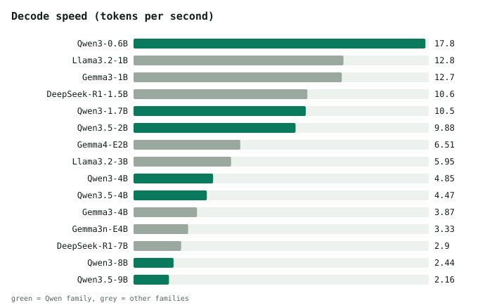
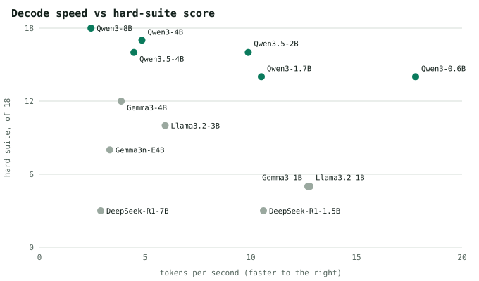
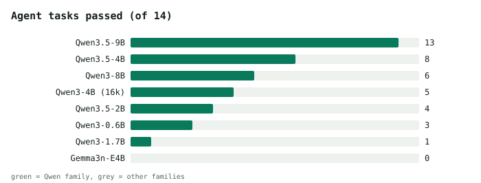
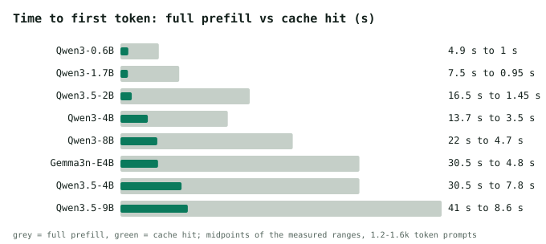

# LLMs on the RK3588S NPU: what works, what doesn't

I tested 15 small models on the RK3588S NPU (NanoPi M6 and R6S, RKLLM 1.3.1) for speed, tool-call accuracy, multi-turn agent tasks, KV-cache reuse and context length. The goal was fully private, fanless, low-power local inference. The hardware delivers all three. It does not deliver much intelligence: it is enough for home automation and triaging a morning news brief, not for an assistant.

Full write-up: [`docs/index.html`](docs/index.html) (GitHub Pages: enable Settings, Pages, deploy from `main` and `/docs`).

## Summary

- **Speed:** decode is memory-bandwidth bound. Qwen3-0.6B does 17.8 tok/s, a 4B about 4.5 to 5, an 8B to 9B about 2 to 2.5.
- **Single tool calls:** the Qwen family takes the top six places on an 18-case hard suite (Qwen3-8B 18/18, Qwen3-4B 17/18). Gemma3, Llama 3.2 and DeepSeek-R1 are clearly worse. Gemma 4 E2B converted badly.
- **Agent tasks:** quiz scores do not predict long-horizon work. Qwen3-8B (18/18 on the quiz) passes 6 of 14 agent tasks. Only Qwen3.5-9B finishes coding tasks (13/14), at about 2 tok/s.
- **KV cache:** reusing the cache removes 82-99% of prefill on every model and cuts time-to-first-token 3 to 7x on short agent tasks. Cache server: [rkllm-go](https://github.com/hanmonic/rkllm-go).
- **Context:** Qwen3.5-4B retrieved a buried needle at every size up to 15k tokens; the cost is latency (about 12 minutes cold at 15k).
- **Safety:** most models followed an instruction injected into a tool result. Gate destructive tools in code.

## Layout

| Path | What |
|---|---|
| `docs/index.html` | the write-up |
| `charts/` | SVG charts (regenerate with `scripts/make_charts.py`) |
| `results/summary.txt` | one-line-per-model summary of suites 1 to 3 |
| `results/suite1-easy`, `suite2-hard`, `suite3-batch`, `context` | raw per-model outputs |
| `results/agent-benchmark/` | reports from the multi-turn agent benchmark, with cache on and off, and the Qwen3.5 live-append experiment |
| `scripts/toolbench*.py` | the tool-call suites (stdlib Python, OpenAI-compatible server, parsers for Qwen JSON/XML, Gemma and generic JSON calls) |
| `scripts/gen_ctx.py` | builds the context-length prompts |

## Method and caveats

- Servers: the vendor `flask_server.py` (suites 1 to 3) and [rkllm-go](https://github.com/hanmonic/rkllm-go) v2 (agent benchmark and cache tests). The vendor server returns tool calls as text, so the scripts parse them.
- Single deterministic run per case (temperature 0), small n: 18 hard-suite cases, 14 agent tasks. One flipped task moves a score by 5 to 25 points. Use the ordering, not the decimals.
- Models are pre-converted builds from Hugging Face by different converters. Gemma3 and DeepSeek have no native tool template, so they are disadvantaged by design.
- Hostnames in test prompts were renamed; the scripts still run as-is against any OpenAI-compatible endpoint.
- Not measured: power draw and temperatures.

## License

Code MIT, text, charts and results CC BY 4.0 (see `LICENSE`).
